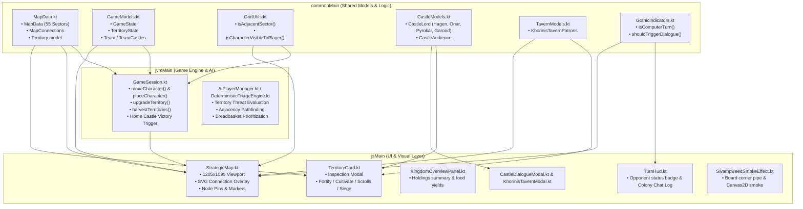

# Gothic Fire: Map Locations, Internal Structure & Code Architecture

This document provides a comprehensive technical and lore summary of all 55 strategic sectors in **Gothic Fire**, the graph network topology, data structures, and the entire code architecture involved in location management, rules enforcement, AI navigation, and frontend rendering.

---

## 1. Executive Summary & Network Topology

The game board represents the island of **Khorinis** from *Gothic 2*, mapped onto a normalized coordinate plane matching the background image [`/gothic_fire_map.png`](file:///home/eudialyte/workspaces/gothic_fire/gothic_fire/gothicfire/src/jsMain/resources/gothic_fire_map.png) ($1205 \times 1095$ pixels).

* **Total Sectors**: **55 sectors** (IDs `"0"` through `"54"`), fully defined in [`MapData.kt`](file:///home/eudialyte/workspaces/gothic_fire/gothic_fire/gothicfire/src/commonMain/kotlin/models/MapData.kt).
* **Graph Connectivity**:
  * **Edges**: 100 undirected paths (200 symmetric directed edges).
  * **Connected Components**: 1 (100% connected graph; every sector is reachable).
  * **Degree Distribution**: Min = 1, Max = 7, Mean = 3.64 connections per node.
* **Central Strategic Hubs (Degree 6–7)**:
  * **Sector 21 (`The Dead Harpy Inn`)** — Degree 7: Central roadhouse connecting North, West, East, and South.
  * **Sector 33 (`Gaan's Crossroads`)** — Degree 7: Southern pass junction linking the Central Plains, High Pastures, and Mountain Ridge.
  * **Sector 31 (`Dexter's Watchtower`)** — Degree 6: Bandit cliff fortress overlooking Onar's estate and mountain trails.
  * **Sector 42 (`Minental Ridge`)** — Degree 6: Southern mountain ridge bottleneck leading to Ancient Pyramids and the Pass.
* **Chokepoints & Dead-Ends (Degree 1)**:
  * **Sector 0 (`Jack's Lighthouse`)** — Northern coastal dead-end (connected only to Sector 3).
  * **Sector 49 (`Xardas's Tower`)** — Southwestern peak redoubt (connected only to Sector 46).
* **Economic Archetypes**:
  * **Breadbaskets (Cultivation 17–18)**: Lobart's Farm (`15`), Akil's Farm (`20`), Sekob's Farm (`17`), Bodo's Wheatfields (`30`), Bengar's Farm (`35`).
  * **Fortified Bastions (Protection 16–20)**: All 4 Castles (`7`, `14`, `23`, `52` with Protection 20), Dexter's Tower (`31`), Jharkendar Portal (`45`), Xardas's Tower (`49`), Valley of Mines Gate (`54`).
  * **Wilderness & Mines (Cultivation 3–5, Protection 10–14)**: Ore shafts (`51`, `53`), Golem Defile (`47`), Black Troll Gorge (`2`).

---

## 2. Complete Inventory of All 55 Locations

| ID | Gothic 2 Lore Name | Type | X | Y | X% | Y% | Deg | Adjacent Sectors | Prot | Cult | Food/Turn | Strategic Role & Lore Context |
|:---:|:---|:---:|:---:|:---:|:---:|:---:|:---:|:---|:---:|:---:|:---:|:---|
| **0** | Jack's Lighthouse | Territory | 288 | 144 | 23.9% | 13.2% | 1 | 3 | 11 | 6 | 3 🌾 | Northern coastal cliff tower; isolated redoubt |
| **1** | Northern Grimwald | Territory | 501 | 165 | 41.6% | 15.1% | 3 | 2, 3, 5 | 7 | 8 | 4 🌾 | Dense northern hunting forest; approach to Black Troll |
| **2** | Black Troll Gorge | Territory | 634 | 176 | 52.6% | 16.1% | 3 | 1, 5, 7 | 12 | 4 | 2 🌾 | Mountain lake & Black Troll lair; northern flank of Monastery |
| **3** | Niclas's Overlook | Territory | 410 | 185 | 34.0% | 16.9% | 5 | 0, 1, 4, 5, 12 | 9 | 7 | 3 🌾 | High cliffside hunter's bluff overlooking the lighthouse road |
| **4** | Vinno's Hollow | Territory | 475 | 291 | 39.4% | 26.6% | 4 | 3, 5, 6, 12 | 7 | 9 | 4 🌾 | Forest depression between North road and Sun Circle |
| **5** | Circle of the Sun | Territory | 555 | 245 | 46.1% | 22.4% | 5 | 1, 2, 3, 4, 7 | 12 | 8 | 4 🌾 | Ancient megalithic ritual altar for the Eye of Innos |
| **6** | Northgate Woods | Territory | 493 | 364 | 40.9% | 33.2% | 3 | 4, 12, 16 | 7 | 10 | 5 🌾 | Timber woods bordering northern city approach |
| **7** | **Monastery of Innos** | **Castle** | 647 | 318 | 53.7% | 29.0% | 4 | 2, 5, 8, 13 | 20 | 14 | 7 🌾 | **Northern Castle**: Fire Mages' highland fortress & sanctuary |
| **8** | Snapper Gorge | Territory | 759 | 328 | 63.0% | 30.0% | 2 | 7, 9 | 8 | 5 | 2 🌾 | Deep canyon prowled by snappers below Monastery cliffs |
| **9** | Misty Cliffs | Territory | 852 | 315 | 70.7% | 28.8% | 2 | 8, 10 | 10 | 4 | 2 🌾 | Foggy northeastern ocean cliffs leading to Shipwreck Cove |
| **10** | Shipwreck Cove | Territory | 940 | 332 | 78.0% | 30.3% | 2 | 9, 19 | 6 | 6 | 3 🌾 | Isolated eastern beach with wrecked smugglers' ships |
| **11** | Khorinis East Gate | Territory | 221 | 411 | 18.3% | 37.5% | 2 | 14, 15 | 14 | 10 | 5 🌾 | Fortified city gatehouse protecting the road to Lobart's Farm |
| **12** | Canthar's Crossroads | Territory | 425 | 382 | 35.3% | 34.9% | 5 | 3, 4, 6, 15, 16 | 6 | 11 | 5 🌾 | Merchant crossroads connecting City, Lobart, and Monastery |
| **13** | Monastery Bridge | Territory | 644 | 408 | 53.4% | 37.3% | 5 | 7, 16, 17, 21, 22 | 11 | 10 | 5 🌾 | Stone bridge by Isgaroth's shrine over the central river |
| **14** | **City of Khorinis** | **Castle** | 150 | 448 | 12.4% | 40.9% | 3 | 11, 25, 26 | 20 | 14 | 7 🌾 | **Western Castle**: Paladin HQ, Governor's palace, & Royal capital |
| **15** | Lobart's Farm | Territory | 362 | 429 | 30.0% | 39.2% | 3 | 11, 12, 20 | 6 | 18 | 9 🌾 | Western breadbasket farm outside city walls |
| **16** | Erol's Bridge | Territory | 551 | 427 | 45.7% | 39.0% | 4 | 6, 12, 13, 21 | 8 | 10 | 5 🌾 | Merchant stone bridge on the north road to Dead Harpy Inn |
| **17** | Sekob's Farm | Territory | 754 | 466 | 62.6% | 42.6% | 5 | 13, 18, 22, 23, 24 | 7 | 17 | 8 🌾 | Northern tenant farm on Onar's estate; prime wheat yields |
| **18** | Crypt of Inubis | Territory | 871 | 466 | 72.3% | 42.6% | 3 | 17, 19, 24 | 11 | 4 | 2 🌾 | Ancient tomb of Lord Inubis; haunted woods behind Sekob |
| **19** | Sagitta's Grove | Territory | 918 | 420 | 76.2% | 38.4% | 2 | 10, 18 | 9 | 13 | 6 🌾 | Eastern forest cave of Sagitta the herbalist & potion brewer |
| **20** | Akil's Farm | Territory | 426 | 515 | 35.4% | 47.0% | 5 | 15, 21, 27, 28, 29 | 7 | 17 | 8 🌾 | Hilltop farm above stone stairway; central breadbasket |
| **21** | The Dead Harpy Inn | Territory | 589 | 521 | 48.9% | 47.6% | 7 | 13, 16, 20, 22, 29, 30, 33 | 12 | 14 | 7 🌾 | Central 7-way hub inn run by Orlan; vital crossroads |
| **22** | Crossroads Graveyard | Territory | 652 | 486 | 54.1% | 44.4% | 5 | 13, 17, 21, 23, 30 | 8 | 9 | 4 🌾 | Forgotten cemetery between the central inn and Onar's farm |
| **23** | **Onar's Farm** | **Castle** | 722 | 512 | 59.9% | 46.8% | 5 | 17, 22, 24, 30, 31 | 20 | 14 | 7 🌾 | **Eastern Castle**: Landowner manor & Mercenary stronghold |
| **24** | Mercenary Grounds | Territory | 842 | 525 | 69.9% | 47.9% | 4 | 17, 18, 23, 31 | 12 | 15 | 7 🌾 | Lee's mercenary training field and sheep pastures |
| **25** | Khorinis Harbor | Territory | 143 | 559 | 11.9% | 51.1% | 2 | 14, 26 | 12 | 15 | 7 🌾 | Port docks, Kardif's tavern, shipyards, & customs house |
| **26** | Smugglers' Beach | Territory | 254 | 575 | 21.1% | 52.5% | 3 | 14, 25, 27 | 8 | 6 | 3 🌾 | Hidden cove & sea caves south of city harbor |
| **27** | Cavalorn's Valley | Territory | 345 | 589 | 28.6% | 53.8% | 3 | 20, 26, 28 | 9 | 8 | 4 🌾 | Sheltered mountain pass with Cavalorn's hunting camp |
| **28** | Bandit Bridge | Territory | 434 | 597 | 36.0% | 54.5% | 5 | 20, 27, 29, 32, 35 | 10 | 8 | 4 🌾 | Fortified wooden ravine bridge linking North & South |
| **29** | Dragomir's Camp | Territory | 544 | 560 | 45.1% | 51.1% | 5 | 20, 21, 28, 32, 33 | 6 | 11 | 5 🌾 | Open meadow campsite south of Dead Harpy Inn |
| **30** | Bodo's Wheatfields | Territory | 717 | 563 | 59.5% | 51.4% | 5 | 21, 22, 23, 31, 33 | 6 | 18 | 9 🌾 | Vast fertile fields and marsh lake feeding Onar's army |
| **31** | Dexter's Watchtower | Territory | 806 | 584 | 66.9% | 53.3% | 6 | 23, 24, 30, 33, 37, 42 | 16 | 5 | 2 🌾 | High mountain palisade & bandit stronghold over Onar's valley |
| **32** | High Pasture Steps | Territory | 527 | 628 | 43.7% | 57.4% | 4 | 28, 29, 33, 36 | 10 | 8 | 4 🌾 | Stone stairway ascending to Bengar's high plateau |
| **33** | Gaan's Crossroads | Territory | 657 | 634 | 54.5% | 57.9% | 7 | 21, 29, 30, 31, 32, 36, 37 | 9 | 10 | 5 🌾 | Major 7-way southern crossroads below the Pass |
| **34** | West Pasture Rim | Territory | 356 | 705 | 29.5% | 64.4% | 2 | 35, 38 | 7 | 9 | 4 🌾 | Western cliff edge above Bengar's southern plateau |
| **35** | Bengar's Farm | Territory | 450 | 718 | 37.3% | 65.6% | 3 | 28, 34, 36 | 7 | 17 | 8 🌾 | Southern high-plateau farm feeding mountain passes |
| **36** | Refugee Waterfall | Territory | 567 | 714 | 47.1% | 65.2% | 4 | 32, 33, 35, 40 | 8 | 13 | 6 🌾 | Waterfalls and river gorge between Bengar and Gaan |
| **37** | Bandit Overlook | Territory | 734 | 681 | 60.9% | 62.2% | 4 | 31, 33, 39, 42 | 13 | 5 | 2 🌾 | Guarded cliff path leading into the southern ranges |
| **38** | Western Crags | Territory | 280 | 737 | 23.2% | 67.3% | 2 | 34, 46 | 11 | 5 | 2 🌾 | Rocky ravine connecting west coast to Xardas's valley |
| **39** | Troll Canyon | Territory | 716 | 754 | 59.4% | 68.9% | 3 | 37, 41, 42 | 12 | 4 | 2 🌾 | Narrow gorge prowled by mountain trolls |
| **40** | Grom's Camp | Territory | 562 | 795 | 46.6% | 72.6% | 4 | 36, 41, 46, 47 | 8 | 10 | 5 🌾 | Woodcutter glade at the base of southern peaks |
| **41** | Shadowbeast Woods | Territory | 658 | 817 | 54.6% | 74.6% | 5 | 39, 40, 42, 47, 48 | 9 | 7 | 3 🌾 | Deep pine forest inhabited by shadowbeasts |
| **42** | Minental Ridge | Territory | 784 | 771 | 65.1% | 70.4% | 6 | 31, 37, 39, 41, 43, 48 | 13 | 6 | 3 🌾 | Critical 6-way mountain ridge flanking the Pass |
| **43** | Ancient Pyramids | Territory | 843 | 823 | 70.0% | 75.2% | 3 | 42, 44, 50 | 14 | 6 | 3 🌾 | Precursor Builder ruins and stepped pyramids |
| **44** | Mages' Excavation | Territory | 988 | 802 | 82.0% | 73.2% | 2 | 43, 45 | 12 | 8 | 4 🌾 | Water Mages' subterranean archaeological dig site |
| **45** | Jharkendar Portal | Territory | 1057 | 838 | 87.7% | 76.5% | 3 | 44, 51, 53 | 16 | 6 | 3 🌾 | Ancient teleporter gatehouse to the forgotten valley |
| **46** | Xardas's Valley | Territory | 407 | 853 | 33.8% | 77.9% | 4 | 38, 40, 47, 49 | 12 | 6 | 3 🌾 | Secluded valley below the Necromancer's spire |
| **47** | Golem Defile | Territory | 612 | 862 | 50.8% | 78.7% | 4 | 40, 41, 46, 48 | 13 | 4 | 2 🌾 | Stone pass guarded by stone and fire golems |
| **48** | Pass Gorge | Territory | 680 | 895 | 56.4% | 81.7% | 4 | 41, 42, 47, 50 | 14 | 4 | 2 🌾 | Steep rocky canyon approach to the Paladin barricade |
| **49** | Xardas's Tower | Territory | 468 | 918 | 38.8% | 83.8% | 1 | 46 | 18 | 6 | 3 🌾 | Necromancer's isolated mountain tower (Dead-end) |
| **50** | Paladin Barricade | Territory | 775 | 918 | 64.3% | 83.8% | 3 | 43, 48, 52 | 16 | 5 | 2 🌾 | Heavy paladin defensive line guarding the Pass |
| **51** | Abandoned Mine Shaft | Territory | 1066 | 949 | 88.5% | 86.7% | 2 | 45, 53 | 13 | 3 | 1 🌾 | High mountain ore mine overlooking the Minental |
| **52** | **Fortress of the Pass** | **Castle** | 859 | 978 | 71.3% | 89.3% | 3 | 50, 53, 54 | 20 | 14 | 7 🌾 | **Southern Castle**: Commander Garond's mountain citadel |
| **53** | Mine Pass Tunnel | Territory | 957 | 963 | 79.4% | 87.9% | 4 | 45, 51, 52, 54 | 14 | 3 | 1 🌾 | Underground cavern route bypassing the surface pass |
| **54** | Valley of Mines Gate | Territory | 893 | 1038 | 74.1% | 94.8% | 2 | 52, 53 | 18 | 4 | 2 🌾 | Great portcullis gate leading into the Penal Colony |

---

## 3. Four Selectable Castles & Neutral Citadels System

During game setup (Lobby), teams pick their **Home Castle**. The 4 strongholds are:

1. **Sector 14 (`City of Khorinis`)**: Western coastal naval capital. Faction: *Paladins & Royal Militia*. Lord: **Lord Hagen**.
2. **Sector 23 (`Onar's Farm`)**: Eastern agrarian basin. Faction: *Lee's Mercenaries*. Lord: **Onar**.
3. **Sector 7 (`Monastery of Innos`)**: Northern river cliffs. Faction: *Circle of Fire Mages*. Lord: **Pyrokar**.
4. **Sector 52 (`Fortress of the Pass`)**: Southern mountain pass. Faction: *Valley Expedition*. Lord: **Commander Garond**.

### Neutral Citadel Mechanics
Any castle not chosen as a player's starting Home Castle spawns as a **Neutral Citadel**:
* **Home Castle Victory Rule**: Conquering an enemy team's registered Home Castle (`gameState.teamCastles`) immediately triggers match victory (`GameStatus.GAME_OVER`). Conquering an unchosen neutral or secondary citadel does **not** end the match; it transfers ownership of a powerful stronghold.
* **Forward Siege Workshop**: Captured citadels allow commanders to craft siege weapons without returning to their home base.
* **Heavy Infantry Requirement**: Captured citadels grant instant high-protection infrastructure ($20$ Protection) required to recruit Heavy Infantry.
* **Disaster Immunity Floor**: Citadels maintain a hard floor of $20$ Protection against Hurricane and Flood natural events.

---

## 4. Internal Structure & Code Architecture

The map and location subsystem is built across **Kotlin Multiplatform (Common, JVM Backend, JS Frontend)**.



### 4.1 Data Models (`commonMain`)

1. **[`MapData.kt`](file:///home/eudialyte/workspaces/gothic_fire/gothic_fire/gothicfire/src/commonMain/kotlin/models/MapData.kt)**:
   * **`Territory` data class**:
     ```kotlin
     data class Territory(
         val id: String,
         val x: Int,
         val y: Int,
         val adjacentIds: List<String>,
         val isCastle: Boolean = false,
         val name: String? = null,
         val protection: Int = if (isCastle) 20 else 5,
         val cultivation: Int = if (isCastle) 14 else 10
     )
     ```
   * Immutable map `val MapData: Map<String, Territory>` containing the authoritative geometric and graph configuration.

2. **[`GameModels.kt`](file:///home/eudialyte/workspaces/gothic_fire/gothic_fire/gothicfire/src/commonMain/kotlin/models/GameModels.kt)**:
   * **`TerritoryState` data class**:
     ```kotlin
     @Serializable
     data class TerritoryState(
         val sectorId: String,
         val ownerPlayerId: String? = null,
         val ownerTeam: Team? = null,
         val cultivation: Int = 10,
         val protection: Int = 5,
         val food: Int = 0,
         val gold: Int = 0
     )
     ```
   * Dynamically tracks runtime mutable state per match inside `GameState.territories`.

3. **[`GridUtils.kt`](file:///home/eudialyte/workspaces/gothic_fire/gothic_fire/gothicfire/src/commonMain/kotlin/models/GridUtils.kt)**:
   * **`isAdjacentSector(from: String, to: String): Boolean`**: Evaluates whether two sectors share an edge in `MapData`.
   * **`isCharacterVisibleToPlayer(...)`**: Implements tactical **Fog-of-War**:
     - All characters visible in Lobby/Game Over.
     - Allies always visible.
     - Characters located inside any Castle are permanently visible.
     - Enemies are visible only if an allied living hero is in the same or an adjacent sector.

4. **[`CastleModels.kt`](file:///home/eudialyte/workspaces/gothic_fire/gothic_fire/gothicfire/src/commonMain/kotlin/models/CastleModels.kt)**:
   * Associates sectors `14`, `23`, `7`, and `52` with their historical lords:
     - `14` $\rightarrow$ Lord Hagen
     - `23` $\rightarrow$ Onar
     - `7` $\rightarrow$ Pyrokar
     - `52` $\rightarrow$ Commander Garond
   * Supports `ConsultCastleLord` action for tactical advice and lore dialogue.

5. **[`TavernModels.kt`](file:///home/eudialyte/workspaces/gothic_fire/gothic_fire/gothicfire/src/commonMain/kotlin/models/TavernModels.kt)**:
   * Defines `SectorSubLocation` and `SectorSubLocations` cataloging all 55 sectors (`"0"` through `"54"`).
   * Every sector features a canonical *Gothic II: Night of the Raven* sub-location, interactive button, and NPC patron(s) (e.g., Old Jack, Bartok, Grimbald, Vatras, Saturas, Xardas, Bennet, Thekla, Engor, etc.) offering insider lore details and *Gothic Fire* strategic hints.
   * Sector 14 preserves the Harbor Tavern of Khorinis patrons (`Kardif`, `Moe`, `Alrik`, `Halvor`, `Valentino`) with dynamic game-state standing evaluation.

---

### 4.2 Backend Game Engine & Rules (`jvmMain`)

1. **[`GameSession.kt`](file:///home/eudialyte/workspaces/gothic_fire/gothic_fire/gothicfire/src/jvmMain/kotlin/game/GameSession.kt)**:
   * **Movement Validation**: `moveCharacter(playerId, targetSector, characterId, strategy)` checks:
     - Adjacency via `isAdjacentSector(char.currentSector, targetSector)`.
     - Hero has not acted this turn.
     - Resolves battle if occupied by enemy, transferring territory ownership upon victory.
   * **Home Castle Conquering**:
     ```kotlin
     if (gameState.teamCastles.any { it.value == targetSector && it.key != attackingPlayer.team }) {
         gameState = gameState.copy(status = GameStatus.GAME_OVER, winningTeam = attackingPlayer.team)
     }
     ```
   * **Territory Upgrades**:
     - `upgradeTerritory(playerId, sectorId, UpgradeType.CULTIVATE, ...)`: increases cultivation by +3.
     - `upgradeTerritory(playerId, sectorId, UpgradeType.FORTIFY, ...)`: increases protection by +3.
   * **Harvest Phase**: At turn completion:
     - Food production: `(cultivation / 2).coerceAtLeast(1)`.
     - Gold production: +1 coin per held sector.
   * **Natural Events**:
     - `ABUNDANT_HARVEST`: Quadruples or triples food gain in target sector.
     - `HURRICANE` / `FLOOD`: Damages protection and cultivation (respecting the citadel 20 protection floor).

2. **[`AiPlayerManager.kt`](file:///home/eudialyte/workspaces/gothic_fire/gothic_fire/gothicfire/src/jvmMain/kotlin/game/AiPlayerManager.kt) & [`DeterministicTriageEngine.kt`](file:///home/eudialyte/workspaces/gothic_fire/gothic_fire/gothicfire/src/jvmMain/kotlin/game/DeterministicTriageEngine.kt)**:
   * Scores adjacent target sectors based on cultivation breadbaskets, protection defensibility, proximity to enemy castles, and tactical threat.

---

### 4.3 Frontend Visual Components (`jsMain`)

1. **[`StrategicMap.kt`](file:///home/eudialyte/workspaces/gothic_fire/gothic_fire/gothicfire/src/jsMain/kotlin/components/StrategicMap.kt)**:
   * **Projection**: Renders into a responsive viewport with `aspect-ratio: 1205 / 1095`. Percentage positioning:
     $$\text{left} = \frac{X}{1205} \times 100\%, \quad \text{top} = \frac{Y}{1095} \times 100\%$$
   * **Connection Layer**: SVG overlay drawing lines between connected sectors, highlighting selected routes in golden amber.
   * **Toolbar**:
     - `🗺️ Show Paths / Hide Paths`: Toggles dynamic SVG topology routes.
     - `🙈 Hide Labels / 👁️ Show Labels`: Clean map mode for unobstructed artwork viewing.
     - `🏷️ All Names / Key Names`: Filters between dense and landmark-only labeling.
   * **Waiting Indicators**:
     - Mounts [`SwampweedSmokeEffect.kt`](file:///home/eudialyte/workspaces/gothic_fire/gothic_fire/gothicfire/src/jsMain/kotlin/components/SwampweedSmokeEffect.kt) along the bottom edge during AI turn calculations.
     - Mounts [`ColonyChatLog.kt`](file:///home/eudialyte/workspaces/gothic_fire/gothic_fire/gothicfire/src/jsMain/kotlin/components/ColonyChatLog.kt) speech bubble every 3rd computer turn.

2. **[`TerritoryCard.kt`](file:///home/eudialyte/workspaces/gothic_fire/gothic_fire/gothicfire/src/jsMain/kotlin/components/TerritoryCard.kt)**:
   * Interactive modal opened upon clicking any territory node.
   * Displays ownership, defense ratings, food/gold storage, stationed heroes, and command buttons (`Fortify`, `Cultivate`, `Search Scrolls`, `Craft Siege Weapon`, `Audience with Lord`, `Visit Tavern`).

3. **[`KingdomOverviewPanel.kt`](file:///home/eudialyte/workspaces/gothic_fire/gothic_fire/gothicfire/src/jsMain/kotlin/components/KingdomOverviewPanel.kt)**:
   * Summarizes all holdings belonging to the player's team: total food output, defense aggregate, and garrisoned units.

---

## 5. Summary of Key Files

| File | Subsystem | Responsibility |
|:---|:---|:---|
| [`MapData.kt`](file:///home/eudialyte/workspaces/gothic_fire/gothic_fire/gothicfire/src/commonMain/kotlin/models/MapData.kt) | Common Models | The 55 sectors, coordinates, adjacencies, and base stats |
| [`GameModels.kt`](file:///home/eudialyte/workspaces/gothic_fire/gothic_fire/gothicfire/src/commonMain/kotlin/models/GameModels.kt) | Common Models | `TerritoryState`, `GameState.territories`, `teamCastles` |
| [`GridUtils.kt`](file:///home/eudialyte/workspaces/gothic_fire/gothic_fire/gothicfire/src/commonMain/kotlin/models/GridUtils.kt) | Common Logic | `isAdjacentSector()` adjacency and Fog-of-War visibility |
| [`CastleModels.kt`](file:///home/eudialyte/workspaces/gothic_fire/gothic_fire/gothicfire/src/commonMain/kotlin/models/CastleModels.kt) | Common Models | Lords of the 4 citadels (Hagen, Onar, Pyrokar, Garond) |
| [`TavernModels.kt`](file:///home/eudialyte/workspaces/gothic_fire/gothic_fire/gothicfire/src/commonMain/kotlin/models/TavernModels.kt) | Common Models | 55-sector sub-location catalog, patrons, and dialogue system |
| [`GameSession.kt`](file:///home/eudialyte/workspaces/gothic_fire/gothic_fire/gothicfire/src/jvmMain/kotlin/game/GameSession.kt) | Backend Engine | Movement, placement, combat, upgrades, and victory rules |
| [`AiPlayerManager.kt`](file:///home/eudialyte/workspaces/gothic_fire/gothic_fire/gothicfire/src/jvmMain/kotlin/game/AiPlayerManager.kt) | Backend AI | Computer player movement and territory evaluation |
| [`StrategicMap.kt`](file:///home/eudialyte/workspaces/gothic_fire/gothic_fire/gothicfire/src/jsMain/kotlin/components/StrategicMap.kt) | Frontend UI | 1205x1095 viewport, SVG paths layer, node pins, unit markers |
| [`TerritoryCard.kt`](file:///home/eudialyte/workspaces/gothic_fire/gothic_fire/gothicfire/src/jsMain/kotlin/components/TerritoryCard.kt) | Frontend UI | Territory inspection dialog with action triggers |
| [`KingdomOverviewPanel.kt`](file:///home/eudialyte/workspaces/gothic_fire/gothic_fire/gothicfire/src/jsMain/kotlin/components/KingdomOverviewPanel.kt) | Frontend UI | Aggregated view of all controlled territories and yields |
| [`SwampweedSmokeEffect.kt`](file:///home/eudialyte/workspaces/gothic_fire/gothic_fire/gothicfire/src/jsMain/kotlin/components/SwampweedSmokeEffect.kt) | Frontend UI | Thematic waiting indicator smoke simulation on lower board edge |
| [`ColonyChatLog.kt`](file:///home/eudialyte/workspaces/gothic_fire/gothic_fire/gothicfire/src/jsMain/kotlin/components/ColonyChatLog.kt) | Frontend UI | Thematic Gothic small talk speech bubble every 3rd computer turn |
