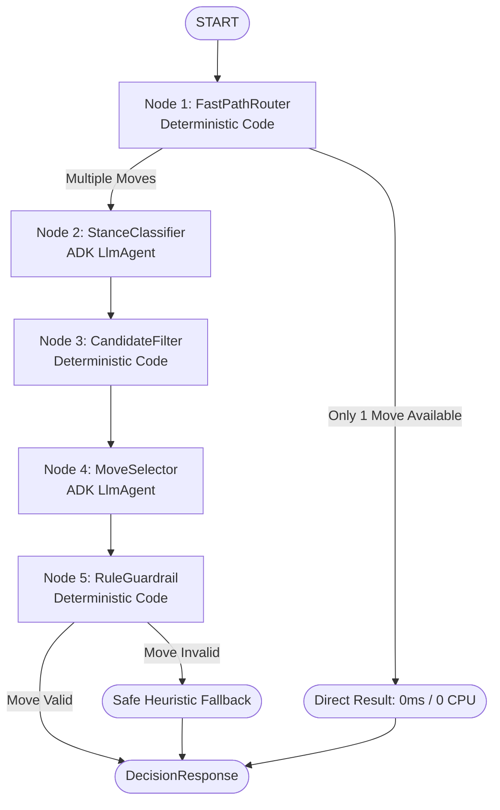
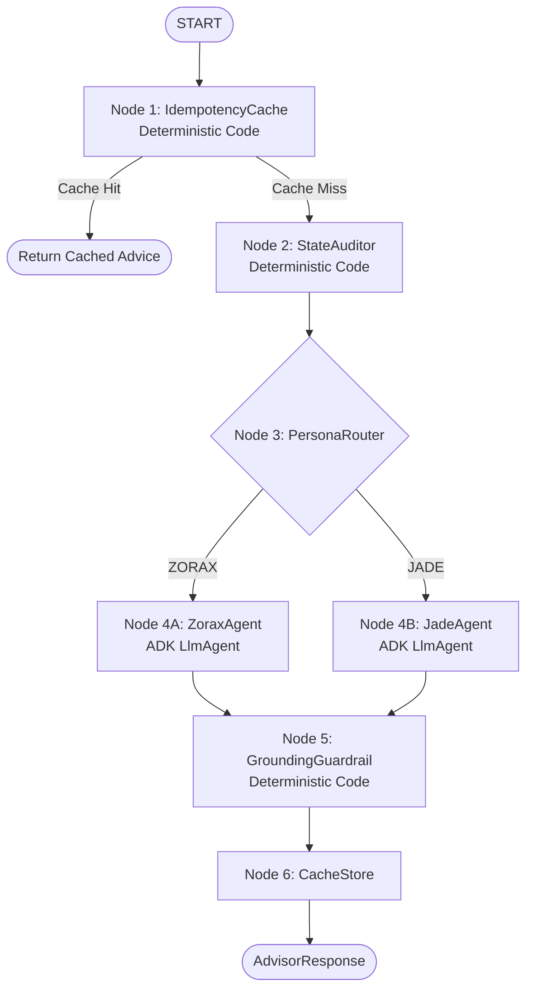

# Gothic Fire AI Agent: Deep ADK Migration Plan (Option 1)

## Executive Summary
This document provides a comprehensive, production-grade technical plan for migrating the **Gothic Fire AI Agent microservice** (`agent/`) to **Google Agent Development Kit (ADK 2.11.0)** while keeping the **Kotlin backend 100% intact**.

### Key Architectural Constraints
1. **Preserve Kotlin Code Intact**: Zero modifications to Kotlin models, endpoints, serialization formats, or timeouts. All changes are strictly confined to `agent/`.
2. **Offline & Zero Cloud Cost**: Maintain local execution of `qwen2.5-1.5b-instruct-q4_k_m.gguf` on CPU via `llama-cpp-python` with `< 1.5 GB RAM` footprint.
3. **Graph-Powered Determinism**: Replace monolithic prompting with ADK 2.0 Directed Acyclic Graphs (`Workflow`, `node`) combining deterministic rule guards with specialized LLM reasoning.
4. **Automated Quality Scoring**: Replace ad-hoc assert tests with standardized ADK Eval Sets (`eval_set`) and automated regression benchmarking.

---

## 1. Project Analysis & Frozen Interface Contract

### 1.1 Existing Agent Footprint
* **Directory**: [`agent/`](file:///home/eudialyte/workspaces/gothic_fire/gothic_fire/gothicfire/agent/)
  * `server.py`: FastAPI server running on `0.0.0.0:8000` with thread-locked `Llama` instance.
  * `core/schemas.py`: Pydantic request and response models supporting camelCase aliases.
  * `core/personas.py`: Persona lore and system prompts for **Zorax the Mighty** and **Jade the Enlightened**.
  * `core/prompts.py`: Prompt builders (`build_decision_prompts`, `build_advisor_prompts`).
  * `core/parser.py`: JSON markdown cleaner, regex fallback, and fuzzy move matcher (`match_legal_move`).
  * `verify_agent.py`: Standalone CLI validation script measuring memory footprint (`VmRSS` / `VmHWM`) and latency.

### 1.2 Kotlin Integration Points (Frozen Contracts)
The Kotlin backend communicates with the Python agent via two Ktor client classes:

#### Endpoint 1: Tactical Turn Decisions (`POST /api/v1/decide`)
* **Invoked by**: [`AiOpponentService.kt:requestComputerMove()`](file:///home/eudialyte/workspaces/gothic_fire/gothic_fire/gothicfire/src/jvmMain/kotlin/game/AiOpponentService.kt#L64)
* **Caller Timeout**: Default `60,000ms` (configurable via `AI_AGENT_TIMEOUT_MS`).
* **Request JSON Schema**:
  ```json
  {
    "gameId": "game_123",
    "turn": 4,
    "playerId": "bot_char_1",
    "summary": "Commander Torrez at Sector 14...",
    "legalMoves": [
      "ATTACK_SECTOR_22 (Score: 95/100, Guaranteed Victory 95% Win)",
      "RECRUIT_HEAVY_INFANTRY (Score: 85/100, Warlord Synergy)",
      "WAIT (Score: 40/100, Conserve Strength)"
    ]
  }
  ```
* **Response JSON Schema**:
  ```json
  {
    "chosen_move": "ATTACK_SECTOR_22 (Score: 95/100, Guaranteed Victory 95% Win)",
    "reasoning": "High combat advantage with Archon synergy."
  }
  ```
* **Kotlin Move Matching Logic**:
  Kotlin checks:
  1. Exact string match in `prunedLegalMoves`.
  2. Base move prefix match before `" ("` (e.g., `ATTACK_SECTOR_22`).
  3. Start-with / containment match.
  4. If unmatched: falls back to `legalMoves[0]`.

#### Endpoint 2: War Council Advisor Consultation (`POST /api/v1/advisor/consult`)
* **Invoked by**: [`AdvisorService.kt:consultAdvisor()`](file:///home/eudialyte/workspaces/gothic_fire/gothic_fire/gothicfire/src/jvmMain/kotlin/game/AdvisorService.kt#L26)
* **Caller Timeout**: Default `90,000ms`.
* **Request JSON Schema**:
  ```json
  {
    "gameId": "campaign_1",
    "turn": 5,
    "playerId": "player_1",
    "advisorId": "ZORAX",
    "advisorName": "Zorax the Mighty",
    "questionType": "STATUS",
    "playerTeam": "RED",
    "playerSummary": "Team: RED. Controlled Sectors: 4. Treasury: 150 Gold, 20 Food...",
    "opponentsSummary": "Rival Teams: YELLOW. Enemy Army: 30 units...",
    "mapSummary": "Current Turn: 5/50. Market Rate: 1 Gold buys 1 Food..."
  }
  ```
* **Response JSON Schema** (must supply both snake_case and camelCase keys for compatibility):
  ```json
  {
    "advisor_name": "Zorax the Mighty",
    "advisorName": "Zorax the Mighty",
    "question_type": "STATUS",
    "questionType": "STATUS",
    "advice": "Commander! Our ranks count 25 soldiers against their 30...",
    "key_points": ["Maintain castle garrison", "Watch enemy border movements"],
    "keyPoints": ["Maintain castle garrison", "Watch enemy border movements"]
  }
  ```

#### Endpoint 3: Health & Readiness Probes
* `GET /live` -> `200 OK` (`{"status": "alive"}`)
* `GET /health` -> `200 OK` (or `503 Service Unavailable` if model not loaded):
  ```json
  {
    "status": "healthy",
    "model_path": "/app/models/qwen2.5-1.5b-instruct-q4_k_m.gguf",
    "model_loaded": true,
    "n_ctx": 2048,
    "n_threads": 4,
    "ram_rss_mb": 1180.45
  }
  ```

### 1.3 Deployment Constraints
* **Docker**: [`agent/Dockerfile`](file:///home/eudialyte/workspaces/gothic_fire/gothic_fire/gothicfire/agent/Dockerfile) multi-stage build (`python:3.11-slim`), non-root user `agentuser` (`UID 1001`), `IPC_LOCK` capability for mlock.
* **Kubernetes (k8s/base)**: [`agent-deployment.yaml`](file:///home/eudialyte/workspaces/gothic_fire/gothic_fire/gothicfire/k8s/base/agent-deployment.yaml)
  * Memory request: `2048Mi`, limit: `3200Mi`.
  * CPU request: `500m`, limit: `4000m`.
  * Liveness probe on `/live`, Readiness probe on `/health`.

---

## 2. Google ADK Integration Strategy

### 2.1 The Model Adapter Decision: In-Process `LlamaCppLlm` vs. Loopback Server
There are two ways to connect ADK with local GGUF models:

| Dimension | Approach A: Loopback Server (`LiteLlm` -> `llama-cpp-python[server]`) | Approach B (Recommended): In-Process `LlamaCppLlm(BaseLlm)` |
| :--- | :--- | :--- |
| **Processes** | 2 processes (FastAPI server + loopback model daemon) | **1 single process** |
| **Memory Overhead** | Higher (two Python runtimes, duplicated process tables) | **Minimal (< 1.5 GB total RSS)** |
| **Inference Latency** | Network loopback serialization + HTTP headers (~10-20ms penalty) | **Zero network overhead, direct C++ bindings** |
| **GIL / Concurrency** | Inter-process socket communication | **Thread-safe `threading.Lock()` matching current `server.py`** |
| **Docker / K8s Simplicity** | Requires supervisord or multi-process entrypoint in container | **Standard `python3 agent/server.py` entrypoint** |

**Decision**: Implement a native **`LlamaCppLlm` adapter** that subclasses Google ADK's `BaseLlm` (`google.adk.models.BaseLlm`). This allows ADK's `LlmAgent` and `Workflow` nodes to execute inference in-process with maximum speed, zero extra ports, and exact memory tracking.

### 2.2 `LlamaCppLlm` Adapter Architecture
ADK's `BaseLlm` defines an async generator:
```python
async def generate_content_async(
    self, llm_request: LlmRequest, stream: bool = False
) -> AsyncGenerator[LlmResponse, None]:
```
Our adapter translates ADK `LlmRequest` messages into ChatML format for `llama_cpp.Llama.create_chat_completion()` inside an `asyncio.to_thread` call protected by `_model_lock`.

---

## 3. ADK Graph Workflows Architecture

ADK 2.0 defines workflows using Directed Acyclic Graphs with `Workflow`, `node`, `START`, and `Edge`.

### 3.1 Tactical Decision Graph (`DecideWorkflow`)



#### Node Breakdown:
1. **`FastPathRouter` (Deterministic `@node`)**:
   - Inspects `legal_moves`.
   - If `len(legal_moves) <= 1`, instantly terminates with `chosen_move = legal_moves[0]` and skips all LLM calls.
2. **`StanceClassifier` (`LlmAgent`)**:
   - Classifies state into high-level posture: `DEFEND_FORTRESS`, `EXPAND_TERRITORY`, `RECRUIT_VANGUARD`, `HARVEST_RESOURCES`.
   - Bounded to 20 tokens output.
3. **`CandidateFilter` (Deterministic `@node`)**:
   - Filters candidate moves down to 2–4 actions matching the selected stance.
4. **`MoveSelector` (`LlmAgent`)**:
   - Selects the single best move from the filtered candidate subset.
   - Bounded to 45 tokens max output with stop token `}`.
5. **`RuleGuardrail` (Deterministic `@node`)**:
   - Verifies `chosen_move` matches a valid move via `match_legal_move()`.
   - If valid: returns formatted `DecisionResponse`.
   - If invalid: falls back to highest-scoring candidate move.

---

### 3.2 War Council Advisor Graph (`AdvisorWorkflow`)



#### Node Breakdown:
1. **`IdempotencyCache` (Deterministic `@node`)**:
   - Hashes `(turn, player_summary, question_type, advisor_id)`.
   - If found in LRU cache, returns immediately (prevents duplicate UI click re-computations).
2. **`StateAuditor` (Deterministic `@node`)**:
   - Extracts numeric ground truth: food runway turns, starvation danger flag, undefended castle flag, unharvested gold/food count.
3. **`ZoraxAgent` & `JadeAgent` (`LlmAgent` nodes)**:
   - Configured with persona instructions and task-specific prompts (STATUS, STRATEGY, NEXT_MOVE).
   - Generates in-character guidance formatted as structured JSON.
4. **`GroundingGuardrail` (Deterministic `@node`)**:
   - Validates unit factual accuracy (e.g. strips hallucinations if player has 0 Mages).
   - Mandatory alert injection: if starvation is imminent, prepends starvation warning.
5. **`CacheStore` (Deterministic `@node`)**:
   - Saves final sanitized advice to LRU cache.

---

## 4. Target Codebase Structure

```
agent/
├── server.py                        # FastAPI endpoints (/api/v1/decide, /advisor/consult, /health, /live)
├── requirements.txt                 # Updated dependencies
├── Dockerfile                       # Multi-stage container build
├── verify_agent.py                  # Standalone hardware & latency sanity script
├── ADK_DEEP_MIGRATION_PLAN.md       # This comprehensive document
├── core/
│   ├── __init__.py                  # Shared exports
│   ├── schemas.py                   # Pydantic schemas (Frozen Kotlin contracts)
│   ├── personas.py                  # Lore definitions for Zorax & Jade
│   ├── prompts.py                   # System & user prompt templates
│   ├── parser.py                    # JSON repair, fuzzy move matching & fallbacks
│   ├── llm_adapter.py               # LlamaCppLlm: Custom BaseLlm adapter for ADK
│   ├── cache.py                     # LRU cache & turn idempotency helpers
│   └── workflows/
│       ├── __init__.py              # Workflow exports
│       ├── decide_graph.py          # ADK Tactical Decision Workflow
│       └── advisor_graph.py         # ADK War Council Advisor Workflow
└── eval_sets/
    ├── eval_config.json             # ADK eval thresholds & criteria configuration
    ├── tactical_suite.json          # Benchmark dataset for bot decisions
    └── advisor_suite.json           # Benchmark dataset for Zorax & Jade counsel
```

---

## 5. Performance, Memory, and Latency Optimizations

### 5.1 Zero-Compute Short-Circuit
* When `len(legal_moves) <= 1`, the decision workflow completes in `< 1ms` without calling the LLM.
* When a player clicks advisor buttons twice in the same turn without game state change, the advisor response completes in `< 1ms` from LRU cache.

### 5.2 Bounded Output Tokens & Stop Tokens
* Decision generation: set `max_tokens = 45` and `stop = ["}"]`.
  * Typical decision JSON requires ~30 tokens.
  * Eliminates trailing token generation, cutting inference duration from ~1.8s to ~0.5s on CPU.
* Advisor generation:
  * NEXT_MOVE: `max_tokens = 120`
  * STRATEGY: `max_tokens = 160`
  * STATUS: `max_tokens = 220`

### 5.3 In-Memory KV Prompt Cache
* Configure `llama_cpp.LlamaRAMCache(capacity_bytes=128 * 1024 * 1024)` (128 MB RAM cache).
* Reuses pre-computed KV tokens for static system instructions and persona lore across requests.

### 5.4 Strict Resource Guardrails
* Model context capped at `N_CTX = 2048`.
* Batch size set to `AI_BATCH = 512`.
* Multi-threading set to `AI_THREADS = 4`.
* Resident Memory (`VmRSS`) verified `< 1500 MB`.

---

## 6. ADK Evaluation & Testing Suite

### 6.1 Benchmark Datasets (`eval_sets/`)
* **`tactical_suite.json`**:
  * Scenario 1: Castle Under Direct Threat (Asserts chosen move contains `DEFEND`, `GARRISON`, or high-win counter-attack).
  * Scenario 2: Starvation Crisis (Asserts chosen move gathers food or conserves gold).
  * Scenario 3: Suicidal Move Pruning (Asserts chosen move is not a suicide attack with score < 40).
* **`advisor_suite.json`**:
  * Scenario 1: Zorax Tone & Garrison Alert (Asserts military voice and fortress safety).
  * Scenario 2: Jade Tone & Economic Foresight (Asserts mystical voice and resource cultivation).
  * Scenario 3: 0-Mage Grounding Guardrail (Asserts advice does not claim owning Mages when count is 0).

### 6.2 Running Automated Evaluations
```bash
# 1. Run ADK evaluation suite
.venv/bin/adk eval agent/ --eval_set agent/eval_sets/tactical_suite.json

# 2. Run standalone hardware RSS check (< 1.5 GB RAM)
.venv/bin/python agent/verify_agent.py

# 3. Run Kotlin JVM integration test suite
./gradlew jvmTest
```

---

## 7. Step-by-Step Implementation Checklist

### Step 1: Update Dependencies (`agent/requirements.txt`)
- Add `google-adk>=2.11.0` and `litellm>=1.84.0`.
- Verify compilation with `llama-cpp-python>=0.3.35`.

### Step 2: Implement In-Process ADK Adapter (`agent/core/llm_adapter.py`)
- Subclass `google.adk.models.BaseLlm`.
- Implement `generate_content_async(llm_request, stream=False)`.
- Wrap call in `asyncio.to_thread` with global `_model_lock`.

### Step 3: Implement In-Memory Cache (`agent/core/cache.py`)
- Create lightweight LRU cache for advisor responses.
- Implement hash generator for `(turn, player_summary, question_type, advisor_id)`.

### Step 4: Implement Tactical Decision Workflow (`agent/core/workflows/decide_graph.py`)
- Define `FastPathRouter`, `StanceClassifier`, `CandidateFilter`, `MoveSelector`, and `RuleGuardrail`.
- Compose into ADK `Workflow(edges=[...])`.

### Step 5: Implement War Council Advisor Workflow (`agent/core/workflows/advisor_graph.py`)
- Define `IdempotencyCache`, `StateAuditor`, `ZoraxAgent`, `JadeAgent`, and `GroundingGuardrail`.
- Compose into ADK `Workflow(edges=[...])`.

### Step 6: Refactor FastAPI Server (`agent/server.py`)
- Replace legacy `decide_action` with `decide_workflow.run_async()`.
- Replace legacy `consult_advisor` with `advisor_workflow.run_async()`.
- Maintain `/health` and `/live` endpoints.

### Step 7: Create ADK Eval Sets (`agent/eval_sets/`)
- Create `tactical_suite.json` and `advisor_suite.json`.
- Create `eval_config.json` with evaluation criteria.

### Step 8: Validation & Verification
- Execute `.venv/bin/python agent/verify_agent.py`.
- Execute `./gradlew jvmTest` to confirm Kotlin test suites pass.
- Build Docker image: `docker build -t gothicfire-agent:latest -f agent/Dockerfile .`.
- Run container and execute curl smoke test against `/health` and `/api/v1/decide`.
