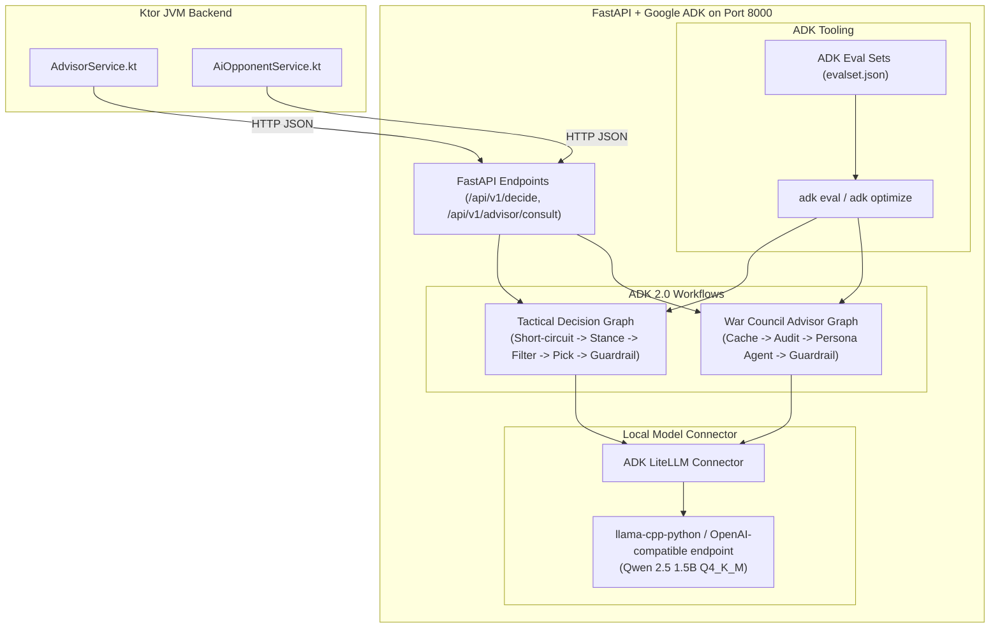
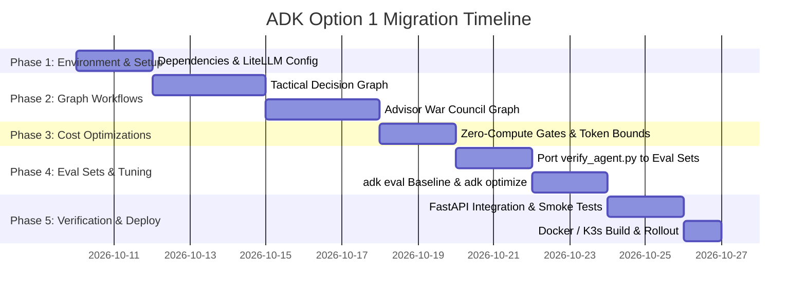

# Gothic Fire AI Agent: ADK Migration Plan (Option 1)

## Executive Summary
This document outlines the end-to-end migration plan for refactoring Gothic Fire's Python AI agent microservice (`agent/`) to use Google's **Agent Development Kit (ADK)** ([adk.dev](https://adk.dev)). 

This migration maintains **Option 1**: preserving the isolated Python microservice on port `8000`, running offline with the local `qwen2.5-1.5b-instruct` GGUF model (< 1.5 GB RAM footprint), while introducing **graph-powered workflows**, **zero-compute cost optimizations**, and **ADK evaluation datasets (`eval_set`)**.

---

## 1. Architectural Blueprint

### Target Architecture


### Guiding Principles
1. **Zero Kotlin API Breakage**: The HTTP interface (`/api/v1/decide`, `/api/v1/advisor/consult`, `/health`, `/live`) and JSON request/response schemas remain 100% identical.
2. **Offline & Budget-Safe**: Runs locally via GGUF CPU inference with strict resident memory constraints (< 1.5 GB RSS).
3. **Deterministic Superiority**: Game rules (legal moves, territory existence, resource counts) are strictly enforced by deterministic Python nodes, not left to LLM probability.

---

## 2. Phased Migration Roadmap



---

### Phase 1: Environment & Dependency Preparation

#### Goals
Integrate ADK and LiteLLM into the Python environment without breaking existing `llama-cpp-python` C++ bindings.

#### Tasks
1. **Update [`agent/requirements.txt`](file:///home/eudialyte/workspaces/gothic_fire/gothic_fire/gothicfire/agent/requirements.txt)**:
   ```text
   fastapi>=0.115.0
   uvicorn[standard]>=0.30.0
   pydantic>=2.8.0
   llama-cpp-python[server]>=0.3.0
   google-adk>=2.0.0
   litellm>=1.40.0
   numpy>=1.26.0
   requests>=2.31.0
   ```
2. **Local Model Interface**:
   - Configure ADK's `LiteLlm` connector to route requests to the local GGUF model via `llama-cpp-python`'s embedded engine or local OpenAI-compatible endpoint (`http://127.0.0.1:8000/v1`).
3. **Verify Container Build**:
   - Update [`agent/Dockerfile`](file:///home/eudialyte/workspaces/gothic_fire/gothic_fire/gothicfire/agent/Dockerfile) to ensure `google-adk` installs cleanly in `python:3.11-slim` builder stage.

---

### Phase 2: Graph Workflow Implementation

#### Goals
Deconstruct monolithic prompts into modular, testable ADK graph nodes.

#### Tasks
1. **Construct Tactical Decision Graph (`agent/core/graphs/decide_graph.py`)**:
   - **Node 1: Fast-Path Router**:
     - If `len(legal_moves) == 0` -> Return fallback `WAIT`.
     - If `len(legal_moves) == 1` -> Return only move immediately (zero LLM inference).
   - **Node 2: Strategic Classifier (LLM)**:
     - Classifies board stance (`DEFEND_CASTLE`, `RECRUIT_ARMY`, `EXPAND_TERRITORY`).
   - **Node 3: Candidate Move Filter (Deterministic)**:
     - Filters the `legal_moves` list to matching candidates.
   - **Node 4: Move Selector (LLM)**:
     - Selects the single best move from the filtered candidate set with strict JSON schema.
   - **Node 5: Rule Guardrail (Deterministic)**:
     - Asserts `chosen_move in legal_moves`. If false, selects highest-heuristic legal fallback.

2. **Construct War Council Advisor Graph (`agent/core/graphs/advisor_graph.py`)**:
   - **Node 1: Idempotency & Cache Check**:
     - Check in-memory LRU cache `hash(turn, player_summary, question_type)`. If hit, return cached advice instantly.
   - **Node 2: Battlefield Auditor (Deterministic)**:
     - Extracts food runway turns, uncollected sector gold/food, and castle garrison alert status.
   - **Node 3: Persona Agent Execution (LLM)**:
     - Route to either **Zorax Agent** (tactical military lens) or **Jade Agent** (mystical economy lens) based on `advisor_id`.
   - **Node 4: Grounding Guardrail (Deterministic)**:
     - Replaces manual regex in [`parser.py`](file:///home/eudialyte/workspaces/gothic_fire/gothic_fire/gothicfire/agent/core/parser.py); verifies and injects critical starvation or garrison alerts if omitted by the model.

---

### Phase 3: Cost, Memory, and Latency Optimizations

#### Goals
Maximize CPU throughput and minimize generation time on local hardware.

#### Tasks
1. **Constrain Generation Tokens**:
   - Reduce decision `max_tokens` from 180 to **45 tokens** with stop sequence `}`.
   - Reduces inference latency from ~1.8s to ~0.5s on CPU.
2. **KV Cache & Prompt Caching**:
   - Configure `llama-cpp-python` with in-memory KV prompt cache (`cache_type="ram"`).
   - Static persona system prompts are evaluated once and cached, eliminating repetitive prompt prefill overhead.
3. **Bounded Memory Profile**:
   - Maintain `n_ctx=2048`, `n_threads=4`, and `n_batch=512`.
   - Confirm resident memory usage remains under 1.5 GB via `get_current_rss_mb()`.

---

### Phase 4: ADK Evaluation Suite (`eval_set`)

#### Goals
Establish automated regression testing and prompt optimization using ADK's native CLI.

#### Tasks
1. **Create Evaluation Datasets (`agent/eval_sets/`)**:
   - `tactical_suite.json`: Contains critical turn test cases:
     - *Case 1: Castle Under Direct Threat* (Enemy adjacent, garrison low -> expects defense).
     - *Case 2: Imminent Starvation* (Food < upkeep -> expects food gathering/recruitment halt).
     - *Case 3: Expansion Advantage* (Border secured -> expects expansion).
   - `advisor_suite.json`: Contains persona consultation cases:
     - *Case 1: Zorax Military Counsel* (Evaluates warlord tone and garrison focus).
     - *Case 2: Jade Arcane Economic Counsel* (Evaluates long-term harvest and pacing).
2. **Integrate ADK CLI Commands**:
   ```bash
   # Run automated regression testing against the local agent
   adk eval agent/ --eval_set agent/eval_sets/tactical_suite.json

   # Automatically optimize and compress system instructions
   adk optimize agent/ --eval_set agent/eval_sets/advisor_suite.json
   ```
3. **Preserve Hardware Sanity Check**:
   - Retain [`agent/verify_agent.py`](file:///home/eudialyte/workspaces/gothic_fire/gothic_fire/gothicfire/agent/verify_agent.py) specifically for measuring hardware RSS memory (`VmRSS`), GGUF load time, and cold-start CPU latency.

---

### Phase 5: FastAPI Integration & Verification

#### Goals
Wire the ADK workflows into the FastAPI endpoints in [`agent/server.py`](file:///home/eudialyte/workspaces/gothic_fire/gothic_fire/gothicfire/agent/server.py).

#### Tasks
1. **Refactor Endpoints**:
   - `/api/v1/decide` executes `decide_graph.run(request)`.
   - `/api/v1/advisor/consult` executes `advisor_graph.run(request)`.
2. **Maintain Compatibility**:
   - Maintain existing `/health` and `/live` endpoints.
   - Ensure response schemas match [`DecisionResponse`](file:///home/eudialyte/workspaces/gothic_fire/gothic_fire/gothicfire/agent/core/schemas.py) and [`AdvisorResponse`](file:///home/eudialyte/workspaces/gothic_fire/gothic_fire/gothicfire/agent/core/schemas.py).
3. **End-to-End Kotlin Test**:
   - Run Kotlin test suites (`./gradlew jvmTest`) to verify [`AdvisorServiceTest`](file:///home/eudialyte/workspaces/gothic_fire/gothic_fire/gothicfire/src/jvmTest/kotlin/game/AdvisorServiceTest.kt) and [`AiOpponentServiceTest`](file:///home/eudialyte/workspaces/gothic_fire/gothic_fire/gothicfire/src/jvmTest/kotlin/game/AiOpponentServiceTest.kt) pass seamlessly against the refactored server.

---

### Phase 6: Containerization & Deployment

#### Goals
Package and deploy the refactored microservice to Docker Compose and K3s.

#### Tasks
1. **Build and Tag Image**:
   ```bash
   docker build -t gothicfire-agent:latest -f agent/Dockerfile .
   ```
2. **Local Smoke Test**:
   ```bash
   docker compose up -d gothicfire-agent
   curl -s http://localhost:8000/health | jq .
   ```
3. **Export and Deploy to K3s**:
   ```bash
   docker save -o gothicfire-agent.tar gothicfire-agent:latest
   sudo k3s ctr images import gothicfire-agent.tar
   kubectl rollout restart deployment/gothicfire-agent -n gothicfire
   ```

---

## 3. Rollback & Contingency Plan

| Scenario | Risk | Mitigation |
| :--- | :--- | :--- |
| **Model Load Failure** | Local GGUF file missing or corrupted | Server startup fallback downloads model automatically via `MODEL_DOWNLOAD_URL` or boots in heuristic-only mode. |
| **Inference Timeout (> 30s)** | Complex turn causes CPU spike | Graph nodes include per-step timeouts and immediately return legal fallback moves. |
| **Excessive RAM (> 1.5 GB)** | ADK graph state overhead | Keep node payload states lightweight (pass IDs and numeric diffs rather than full historical board trees). |
| **Emergency Rollback** | Regressed behavior in live game | Revert `agent/Dockerfile` and `agent/server.py` to pre-migration git commit; rebuild container. |
